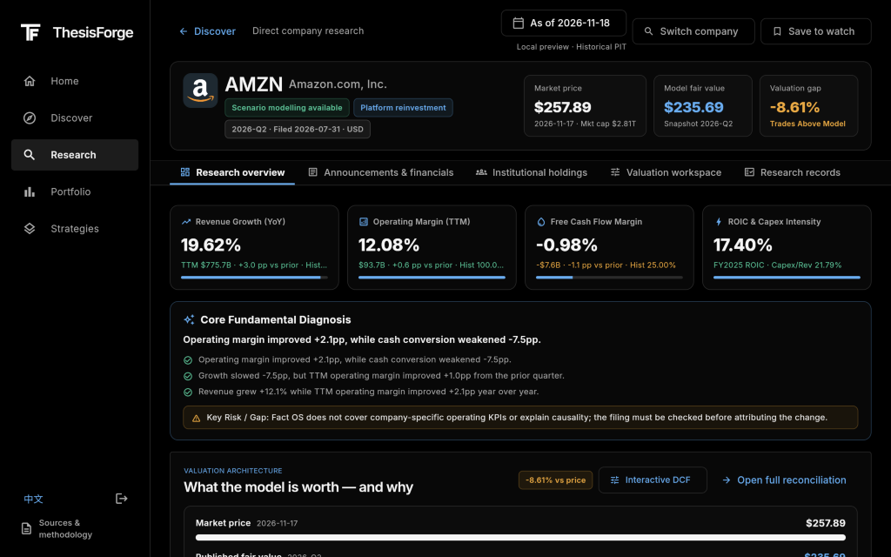
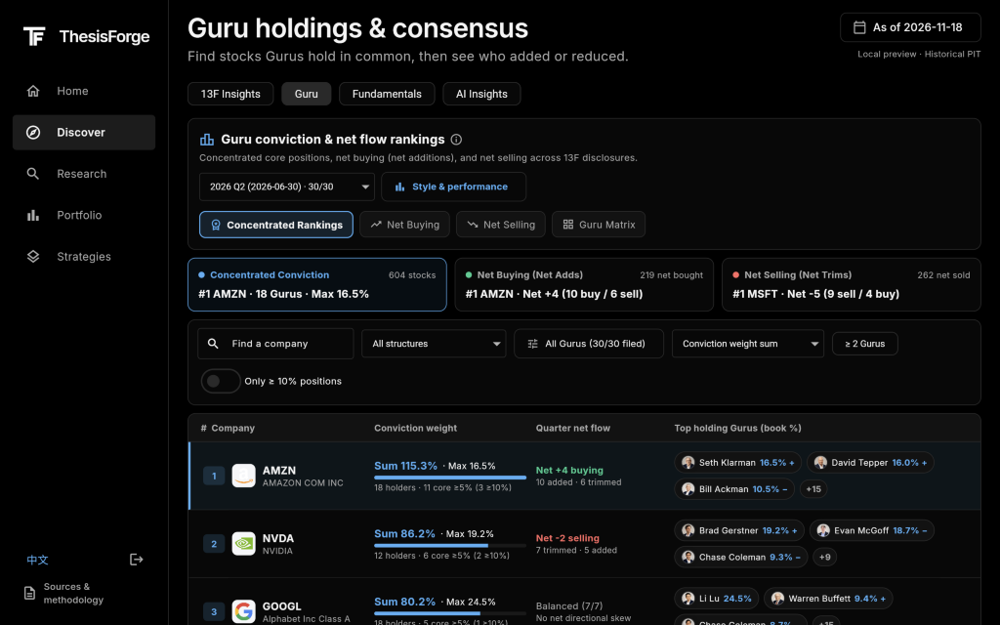
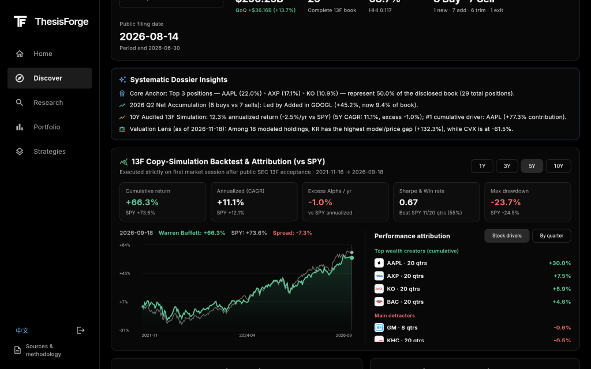
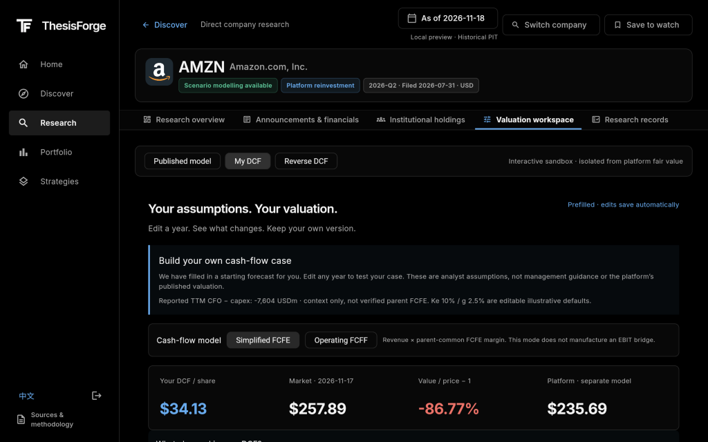
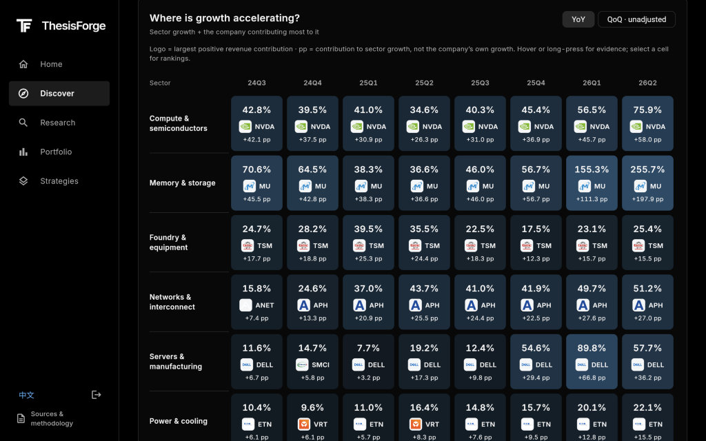
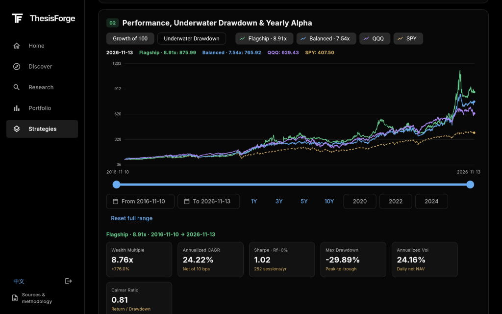
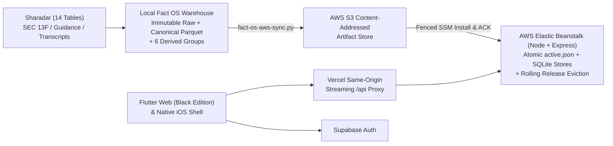

<div align="center">
  
  <h1>ThesisForge</h1>
  <p><strong>Point-in-time public-equity research, institutional 13F intelligence, quantitative strategies, and private multi-account portfolio analytics.</strong></p>
  <p>
    Audit what the market actually knew at any date, track high-conviction institutional books,
    underwrite companies from reported fundamentals, and monitor confirmed passive income in one Black Edition research terminal.
  </p>
  <p>
    <a href="https://www.thesisforge.tech"><strong>Open the terminal</strong></a>
    &nbsp;&middot;&nbsp;
    <a href="AGENTS.md">Agent Operating Contract</a>
    &nbsp;&middot;&nbsp;
    <a href="docs/deployment-contract.md">Deployment Contract</a>
  </p>
  <p>
    
    
    
    
    
    
  </p>
</div>



<p align="center"><sub><strong>Company Research Cockpit:</strong> persistent executive valuation header, 4-card operating &amp; ROIC KPI strip, automated Fact OS fundamental diagnosis, and published model reconciliation.</sub></p>

---

## Product Overview

ThesisForge is a bilingual (`EN` / `中文`), high-density buy-side research and portfolio workspace built around strict **point-in-time (PIT) provenance**: every financial ratio, institutional position, valuation input, and backtest signal is anchored to what was publicly observable on or before the selected `As of` date.

## Core Modules & Visual Walkthrough

| Module | What It Answers | Key Workflows |
| :--- | :--- | :--- |
| **Home** | What needs attention in my book and research today? | Unified multi-account NAV trajectory, top movers, holdings pulse, privacy masking, and thesis review alerts |
| **Discover · Guru & 13F** | Where is institutional conviction concentrating or rotating? | Concentrated-conviction, net-buying, and net-selling leaderboards, cross-manager matrix, active-fund sector rotations, and full single-Guru research dossiers |
| **Discover · Fundamentals & AI Insights** | Which sectors and companies are hitting fundamental inflections? | Multi-quarter revenue acceleration matrices, top sector contributors (`+pp`), ROIC/margin screeners, and PNG/CSV research exports |
| **Research** | What is a company worth from reported filings, and what is my thesis? | Executive company hero, 3-statement interactive comparison charts, bilingual earnings Q&A, SEC/UK guidance, Form 4 insider activity, 3-mode Valuation Workspace (`Published model` / `My DCF` / `Reverse DCF`), and persistent research records |
| **Portfolio** | How is my real multi-account brokerage book performing and generating cash? | Encrypted multi-account IBKR Flex & read-only broker aggregation, confirmed passive income ledger (settled net dividends vs expired OTM short calls, annual history & same-period YoY), and portfolio valuation/Guru overlap |
| **Strategies** | How do systematic factor and tactical rules perform without survivorship bias? | Rule portfolios (`Quality Top 10`, `Ackman Top 20`), `Hot Breakout Pullback` (delisting-inclusive), `QQQ ⇄ SCHD Valuation & Panic Rotation`, and custom `Strategy Builder` |
| **Admin** | Are all data planes, curves, and storage volumes healthy? | Multi-module freshness diagnostics, release verification, and encrypted user-store operations |

---

### 1. Institutional Consensus Leaderboards & Single-Guru Research Dossier



<p align="center"><sub><strong>Guru Consensus 3-Leaderboards:</strong> rank the institutional universe by concentrated book conviction, net buying (net additions), and net selling (net trims), or compare managers side by side in the Guru Matrix.</sub></p>



<p align="center"><sub><strong>Single-Guru Research Dossier:</strong> quantitative style DNA, auto-synthesized dossier insights, filing-execution-dated 13F copy-simulation vs SPY, cumulative stock attribution, quarterly operations, and dated ThesisForge valuation overlays.</sub></p>

---

### 2. Three-Mode Interactive Valuation Workspace & AI Insights



<p align="center"><sub><strong>Valuation Workspace:</strong> inspect the platform's published economic-profile model alongside an isolated personal DCF sandbox (<code>Simplified FCFE</code> &amp; <code>Operating FCFF</code> with optimistic auto-save) and single-variable <code>Reverse DCF</code>.</sub></p>



<p align="center"><sub><strong>AI Insights:</strong> track quarterly YoY and QoQ sector growth inflections paired with the exact company contributing the largest percentage-point acceleration.</sub></p>

---

### 3. Survivorship-Free Quantitative & Tactical Strategy Portfolios



<p align="center"><sub><strong>Strategies Workspace:</strong> full-cycle equity curves, underwater drawdown ribbons, lot-level trade ledgers (including delisted equities), and daily Fact OS updates across rule-based and tactical rotation portfolios.</sub></p>

---

## System & Data Architecture



### Key Architectural Invariants
- **Deployment Split**: Vercel serves the compiled Flutter web frontend (`thesisforge.tech` and `www.thesisforge.tech` aliased to the same `trunk` deployment) and streams `/api/*` requests to AWS Elastic Beanstalk.
- **Immutable & Content-Addressed Fact OS**: Raw provider archives (`data/fact_os/raw`) and derived Parquet/SQLite generations (`canonical`, `public_observations`, `research_inputs`, `institutional_13f`, `ai_insights`, `strategy_inputs`) publish manifest-last and atomically switch on EC2 via `/var/app/data/fact-os/active.json`, retaining `active + rollback` generations after S3 verification.
- **Strict Private/Public Separation**: User brokerage credentials, multi-year passive income ledgers, watchlists, and DCF worksheets are AES-GCM encrypted / owner-scoped inside `USER_DATA_ROOT` on the backend and never enter Git, Fact OS, or client bundles.

---

## Local Development

```bash
npm install
flutter pub get
npm run dev
```

| Service | Local URL |
| :--- | :--- |
| Flutter Web Client | `http://127.0.0.1:5174` |
| Express API Server | `http://127.0.0.1:8787` |

---

## All-Corners Data Refresh & Common Operations

```bash
# Full end-to-end daily/earnings data sync across Fact OS (14 tables + 6 groups),
# tactical strategy artifacts (QQQ <-> SCHD & Breakout Pullback), and AWS activation:
npm run refresh:all-corners

# Run local Fact OS Sharadar sync only:
npm run fact-os:sync

# Check local vs AWS S3/EC2 active Fact OS release status:
npm run fact-os:aws-status

# Publish and atomically activate verified local Fact OS artifacts on AWS:
npm run fact-os:aws-sync

# Build production Flutter web bundle & package AWS backend:
npm run build
npm run package:aws
```

### Quality Gates

```bash
flutter analyze
flutter test
npm run test:server
npm run test:proxy
npm run test:performance
.venv-fact-os/bin/python -m unittest discover -s fact_os -p 'test_*.py'
```

Full operational contracts for **All-Corners Earnings & Market Refreshes**, **13F Updates**, **PIT Valuations**, **AWS Rolling Retention**, and **GitHub Screenshot Synchronization** live in [AGENTS.md](AGENTS.md).

---

## Security & Disclaimer

- Brokerage tokens (IBKR Flex / read-only connectors) are encrypted at rest on the backend and isolated per authenticated Supabase user UUID.
- Runtime databases, licensed market datasets, credentials, and private user ledgers are strictly excluded from version control.

> **Research software, not investment advice.** All valuation outputs, institutional 13F simulations, and quantitative strategy series depend on historical source disclosures and stated modeling assumptions; they are provided strictly as research evidence and never as instructions to buy or sell any security.
